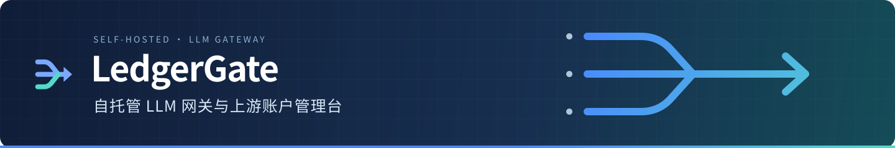
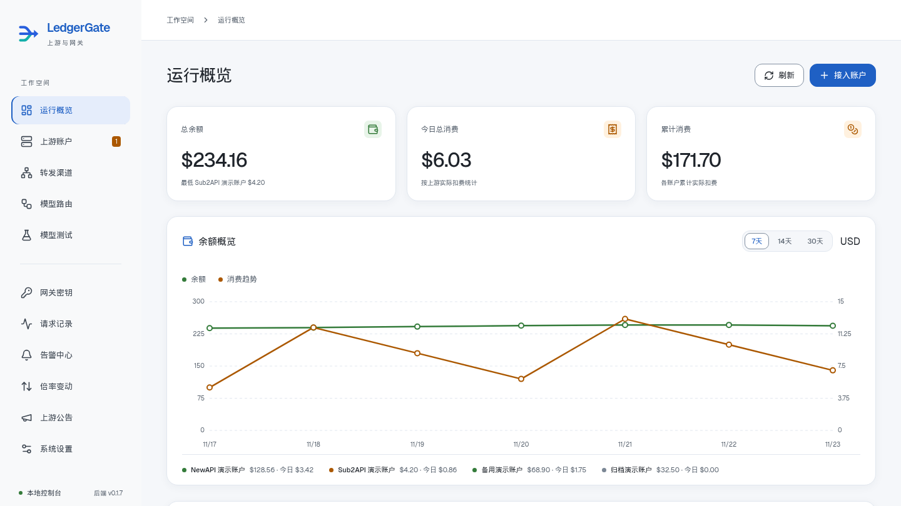
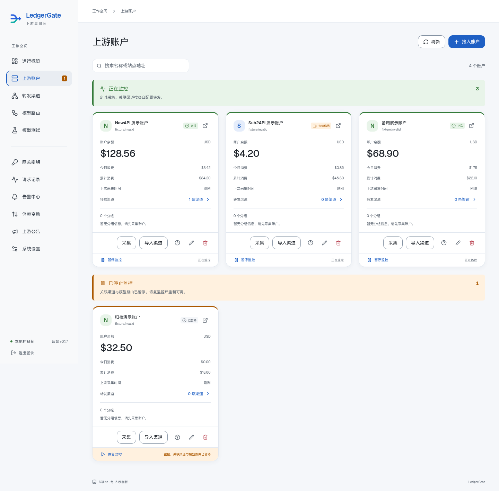

<div align="center">
  
  <p>集中查看上游余额与消费，把多个渠道接到同一个 API，跟踪每次请求的用量和费用。</p>
  <p><strong>单个 Go 程序</strong> · SQLite · Docker · OpenAI Chat / Responses / Anthropic Messages</p>
  <p>
    <a href="#快速开始"><strong>快速部署</strong></a> ·
    <a href="#核心功能">核心功能</a> ·
    <a href="docs/usage.md">使用指南</a> ·
    <a href="https://github.com/sectsnow/LedgerGate/releases">版本说明</a>
  </p>
</div>

## 界面预览

<picture>
  <source media="(prefers-color-scheme: dark)" srcset="docs/images/overview-preview-dark.png">
  
</picture>

支持浅色、深色和跟随系统。以上为概览局部，完整界面见[更多截图](#更多截图)；所有截图使用本地演示数据。

## 核心功能

<table>
  <tr>
    <td width="50%" valign="top">
      <h3>01 · 账户与告警</h3>
      <p>接入 NewAPI / Sub2API，集中查看余额、消费、倍率与订阅。支持本地保存网站图标、自动登录与续期，以及余额、采集异常和订阅提醒。</p>
    </td>
    <td width="50%" valign="top">
      <h3>02 · 渠道与路由</h3>
      <p>统一模型名称，按优先级切换、加权轮询或手动选路。导入密钥、批量管理渠道，同步模型并进行单个或批量测试。</p>
    </td>
  </tr>
  <tr>
    <td width="50%" valign="top">
      <h3>03 · 多协议接入</h3>
      <p>支持 OpenAI Chat、Responses、Anthropic Messages，同协议转发与跨协议转换，保留 SSE 流式输出。</p>
    </td>
    <td width="50%" valign="top">
      <h3>04 · 请求与费用</h3>
      <p>查看进行中请求、近期响应与上游尝试，复制请求 ID、导出脱敏详情，统计 Token、缓存命中和费用估算。用量趋势与渠道、模型表现持久化保存。</p>
    </td>
  </tr>
</table>

通知支持 Webhook、Telegram、Email、企业微信、钉钉、飞书和 Server酱。提供全局出站代理、凭据加密、网页备份恢复与选择性配置迁移。

## 快速开始

### Docker 镜像部署

安装 Docker Engine 和 Docker Compose，在空目录中将以下内容保存为 `compose.yaml`。直接拉取已发布镜像，无需克隆仓库或安装编译工具。

```yaml
services:
  ledgergate:
    image: ghcr.io/sectsnow/ledgergate:0.1.7
    restart: unless-stopped
    ports:
      - "8081:8080"
    volumes:
      - "./data:/data"
    read_only: true
    tmpfs:
      - /tmp:rw,noexec,nosuid,size=64m
    cap_drop:
      - ALL
    cap_add:
      - DAC_OVERRIDE
      - FOWNER
    security_opt:
      - no-new-privileges:true
    stop_grace_period: 30s
    logging:
      driver: json-file
      options:
        max-size: "10m"
        max-file: "3"
```

```bash
docker compose pull
docker compose up -d
```

打开 `http://服务器IP:8081`，首次访问时设置管理员密码。数据保存在 Compose 文件旁的 `data` 目录，更新容器时继续使用该目录；宿主机端口可将 `8081` 改成其他空闲端口。

当前发布镜像为 **Linux / amd64**，默认以容器内 root 运行，便于 NAS 本地目录挂载；权限配置与升级、备份步骤见 [Docker 部署](docs/docker.md)。镜像版本与更新内容见[正式 Release](https://github.com/sectsnow/LedgerGate/releases)。

<details>
  <summary>从源码构建和运行</summary>

需要源码仓库访问权限、Go 1.26.10+、Node.js 22.12+ 和 pnpm 10.4.0（通过 Corepack 使用）。

```bash
git clone https://github.com/sectsnow/LedgerGate.git
cd LedgerGate
make build
./bin/ledgergate
```

本机访问 `http://127.0.0.1:8080`；局域网设备使用 `http://服务器IP:8080`。构建后的程序运行时无需 Go、Node.js 或独立数据库。更多运行参数见[部署与数据维护](docs/deployment.md)。

</details>

## 接入客户端

1. **接入上游**：添加账户并采集，创建或导入转发渠道。
2. **配置模型**：同步渠道模型，在“模型路由”配置客户端模型名及上游路由。
3. **填写客户端配置**：在“网关密钥”创建 Key，填入客户端，并将 API Base URL 设为 `http://服务器IP:8081/v1`。

可用接口：`/v1/models`、`/v1/chat/completions`、`/v1/responses`、`/v1/messages`。地址中的端口应与实际部署一致。

<details>
  <summary>查看 API 调用示例</summary>

例如，创建名为 `personal-assistant` 的模型路由，并在当前终端的 `LEDGERGATE_API_KEY` 环境变量中设置网关 Key：

```bash
curl http://127.0.0.1:8081/v1/chat/completions \
  -H "Authorization: Bearer $LEDGERGATE_API_KEY" \
  -H "Content-Type: application/json" \
  -d '{"model":"personal-assistant","stream":true,"messages":[{"role":"user","content":"你好"}]}'
```

示例对应本机 Docker 部署；远程客户端替换服务器地址，源码部署默认使用 8080 端口。

</details>

## 更多截图

<details>
  <summary>完整运行概览：余额趋势、请求活跃度与网关用量</summary>

  <picture>
    <source media="(prefers-color-scheme: dark)" srcset="docs/images/overview-dark.png">
    
  </picture>
</details>

<details>
  <summary>上游账户管理：正在监控与已停止监控的账户</summary>

  <picture>
    <source media="(prefers-color-scheme: dark)" srcset="docs/images/accounts-dark.png">
    
  </picture>
</details>

## 文档

| 文档 | 内容 |
| --- | --- |
| [使用指南](docs/usage.md) | 首次配置、余额与告警、渠道管理、协议边界、模型测试和用量统计。 |
| [Docker 部署](docs/docker.md) | 镜像拉取、NAS 挂载、端口设置、更新与数据迁移。 |
| [部署与数据维护](docs/deployment.md) | 运行参数、管理员密码、systemd、网页备份恢复和配置导入导出。 |
| [版本说明](https://github.com/sectsnow/LedgerGate/releases) | 正式版本变化与升级注意事项。 |

## 使用说明

- 面向个人使用和单实例部署。账户采集状态与推理 API 健康分别处理，支持暂停账户监控并联动暂停关联路由。
- 近期请求与正文保存在内存中，最多保留 50 条已结束请求，并受 32 MiB 序列化容量限制；重启后清空。用量、费用及渠道/模型统计持久化保存，详细保留规则见[使用指南](docs/usage.md#请求记录与数据维护)。
- 新账户余额阈值默认 `0`，表示关闭余额告警；账户余额按上游实际计价单位展示，不做汇率换算。网关费用为美元估算，以实际账单为准。
- 跨协议转换覆盖文本、工具调用和消息图片等常用能力；有状态续接、内建工具及部分扩展参数的边界见[使用指南](docs/usage.md#行为边界)。
- 数据库、`master.key` 和管理员密码文件需一并保存。升级前请下载加密备份，并阅读目标版本的升级说明。

项目独立实现，以 UpstreamOps 和 Octopus 的功能需求为参考。后端使用 Go、Gin、GORM 和 SQLite，前端使用 React、TypeScript 和 Vite，构建后由一个 Go 程序提供页面与 API。
