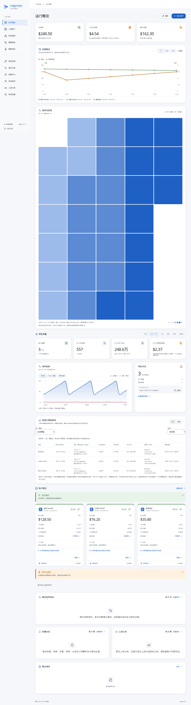

<div align="center">
  
  <h1>LedgerGate</h1>
  <p><strong>上游账户监控 · LLM API 聚合 · 协议转换</strong></p>
  <p>在一个自托管控制台中管理账户余额、转发渠道、模型路由与请求记录。</p>
  <p>
    <a href="#核心功能">核心功能</a> ·
    <a href="#快速开始">快速开始</a> ·
    <a href="docs/usage.md">使用指南</a> ·
    <a href="docs/docker.md">Docker 部署</a>
  </p>
  <p>Go · React · TypeScript · SQLite</p>
</div>

## 界面预览

<picture>
  <source media="(prefers-color-scheme: dark)" srcset="docs/images/overview-dark.png">
  
</picture>

界面支持浅色、深色和跟随系统。截图使用本地演示数据。

<details>
  <summary>查看上游账户管理</summary>

  <picture>
    <source media="(prefers-color-scheme: dark)" srcset="docs/images/accounts-dark.png">
    
  </picture>
</details>

## 核心功能

| 能力 | 说明 |
| --- | --- |
| 上游账户运维 | 接入 NewAPI / Sub2API，自动登录与续期，采集余额、今日与累计消费、倍率、公告和订阅。 |
| 告警与通知 | 余额、采集异常、倍率变动和订阅提醒；支持 Webhook、Telegram、Email、企业微信、钉钉、飞书和 Server酱。 |
| API 聚合与路由 | 统一模型名称，支持手动选择、加权轮询、优先级故障切换、失败冷却及恢复探测。 |
| 协议转换 | 接入 OpenAI Chat、Responses、Anthropic Messages，支持同协议转发、跨协议转换及 SSE 流式输出。 |
| 渠道与模型管理 | 导入已有上游密钥、在上游生成新密钥、批量管理渠道，预览并勾选要同步的模型。 |
| 模型测试 | 使用已保存或临时 Key 单个、批量测试，查看首 Token 延迟、总耗时、Token、缓存用量与错误。 |
| 请求与费用 | 查看进行中请求、分页历史、折叠 JSON 详情、渠道表现、缓存用量和费用估算。 |
| 自托管与维护 | 单个 Go 程序、SQLite、Docker、全局代理、凭据加密、备份恢复及选择性配置迁移。 |

## 快速开始

### Docker Compose

安装 Docker Engine 和 Docker Compose 后，克隆仓库并从源码构建：

```bash
git clone https://github.com/sectsnow/LedgerGate.git
cd LedgerGate
docker compose up -d --build
```

浏览器打开 `http://服务器IP:8081`，首次访问时设置管理员密码。数据保存在 Docker 命名卷中，重建容器后继续保留。可通过 `LEDGERGATE_PORT` 修改宿主机端口。

镜像发布、从 GHCR 拉取、数据挂载及迁移步骤见 [Docker 部署说明](docs/docker.md)。

从 `0.1.1` 起，镜像默认以容器内 root 运行，便于 NAS 直接使用 `./data:/data`。`0.1.0` 默认以 UID 10001 运行，继续使用旧版时可在 Compose 中设置 `user: "0:0"`。

### 从源码运行

需要 Go 1.26.10+、Node.js 22.12+ 和 pnpm 10.4.0（通过 Corepack 使用）。在仓库根目录执行：

```bash
make build
./bin/ledgergate
```

本机访问 `http://127.0.0.1:8080`；局域网设备使用 `http://服务器IP:8080`。构建后的程序运行时无需 Go、Node.js 或独立数据库。

## 接入客户端

1. 添加上游账户并采集，创建或导入转发渠道。
2. 同步渠道模型，在“模型路由”配置客户端模型名及上游路由。
3. 在“网关密钥”创建客户端 Key，将客户端的 API Base URL 设为 `http://服务器IP:端口/v1`。

例如，创建名为 `personal-assistant` 的模型路由，并在环境变量 `LEDGERGATE_API_KEY` 中设置网关 Key：

```bash
curl http://127.0.0.1:8080/v1/chat/completions \
  -H "Authorization: Bearer $LEDGERGATE_API_KEY" \
  -H "Content-Type: application/json" \
  -d '{"model":"personal-assistant","stream":true,"messages":[{"role":"user","content":"你好"}]}'
```

上例使用本机源码部署的 8080 端口；Docker 默认改用 8081，远程客户端还需替换服务器地址。网关同时提供 `/v1/models`、`/v1/responses` 和 `/v1/messages`。

## 文档

| 文档 | 内容 |
| --- | --- |
| [使用指南](docs/usage.md) | 首次配置、余额单位与告警、网络代理、渠道管理、模型测试、请求记录及协议边界。 |
| [部署与数据维护](docs/deployment.md) | 运行参数、管理员密码、systemd、开发环境、备份恢复和配置导入导出。 |
| [Docker 部署](docs/docker.md) | 本地构建、GHCR 发布与拉取、数据卷、更新及迁移。 |

## 使用说明

- 面向个人使用和单实例部署。账户采集状态与推理 API 健康分别处理，支持暂停账户监控并联动暂停关联路由。
- 新账户余额阈值默认 `0`，表示关闭余额告警；账户余额单位按上游实际计价选择，不做汇率换算。网关费用为美元估算，以实际账单为准。
- 跨协议转换覆盖文本、工具调用和消息图片等常用能力；有状态续接、内建工具及部分扩展参数有使用边界，详见使用指南。
- 数据库、`master.key` 和管理员密码文件需一并保存。迁移或升级前可在控制台下载加密备份。

项目独立实现，以 UpstreamOps 和 Octopus 的功能需求为参考。后端使用 Go、Gin、GORM 和 SQLite，前端使用 React、TypeScript 和 Vite，构建后由一个 Go 程序提供页面与 API。
